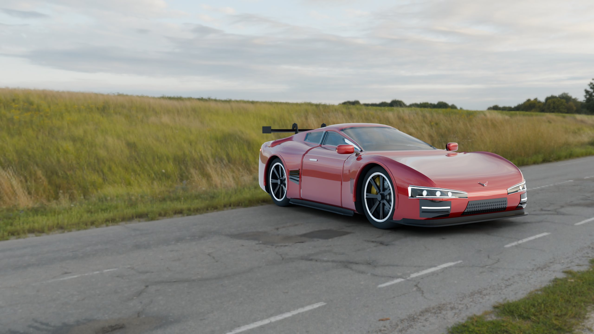

# VENTO: Prototype Series

The website for **Vento**, a fictional Italian car brand with three prototype cars designed in code and modelled in Blender.
It includes a live 3D configurator: pick a model, a paint and wheels, turn the car and open its doors in the browser.

> **Live demo:** turn on GitHub Pages (Settings → Pages → Source: GitHub Actions) and the site deploys itself on every push.



## The three prototypes
| Model | Type | Length | Wheelbase | Height | Signature details |
|---|---|---|---|---|---|
| **Vento GT** | Sports coupé | 4 376 mm | 2 457 mm | 1 212 mm | Swan-neck wing, L-shaped side skirt, blade headlights |
| **Vento Arco** | Hybrid luxury saloon | 4 913 mm | 2 960 mm | 1 437 mm | Falcon mascot, vertical-slat grille, gold coachline |
| **Vento Cima** | Electric SUV | 4 727 mm | 2 950 mm | 1 727 mm | Lit pixel grille, floating black roof, full-width light bar |

Dimensions are measured from the Blender models.

## What's on the site
- **Hero** with a Cycles render of the GT on location
- **Model sections**: location photography, a technical side elevation with dimension lines, specs and a photo gallery with a lightbox
- **Interior**: cabin renders of all three cars
- **Process**: how I built the cars, from reference brands to the browser
- **Configurator**: real-time 3D with paint and finish, wheel design and finish, brake calipers, leather, trim, ambient light, headlights on/off, opening doors, a cabin camera and a shareable build code. The 3D view only starts when you scroll near it, so the page loads fast.

## How the cars were made
1. **Reference:** Porsche, Rolls-Royce, Mercedes-Benz and Range Rover. Proportions first.
2. **Parametric body:** a Python script in Blender lofts each body from profile curves (roof line, shoulder, floor) and cross-sections. Changing one number reshapes the whole car.
3. **Details:** lights, grilles, mirrors, badges and wheels are generated and ray-cast onto the body surface.
4. **Rendering:** location shots lit with HDR environments (Poly Haven, CC0) and rendered in Cycles.
5. **Configure:** each car is one glTF file with fixed part names; React Three Fiber recolours, swaps and opens those parts live.

## Tech
Blender + Python · Cycles · glTF · React · React Three Fiber · drei · Three.js · Vite

## Run it locally
```bash
npm install
npm run dev
```
Then open the link it prints (usually http://localhost:5173).

Build for hosting (the base path is relative, so GitHub Pages works as-is; `.github/workflows/deploy.yml` builds and publishes it automatically):
```bash
npm run build      # output in dist/
```

## Project structure
```
public/models/   vento_gt.glb, vento_arco.glb, vento_cima.glb (exported from Blender)
public/img/      studio renders used on the page
src/content.js   all text, specs, paints, wheels and camera views
src/Site.jsx     the page: hero, models, process, configurator section
src/Configurator.jsx   the 3D configurator
src/GlbCar.jsx   loads a car and connects paint, doors and rims by name
```

## How the configurator finds parts
| In Blender | What the code does |
|---|---|
| Material named `Paint` | Gets the colour and finish you pick |
| Materials ending in `_Leather`, `_Accent`, `_Ambient`, `_Caliper` | Leather, trim, ambient light and caliper colours |
| Material named `Glass` | Replaced by tinted see-through glass |
| Objects `Door_L`, `Door_R`, `Door_RearL`, `Door_RearR` with their origin on the hinge | Swing open on click |
| Rims named `Rim_aero`, `Rim_sport`, `Rim_turbina` | Only the selected design is visible |

## Note
Vento is a fictional brand and a personal design and engineering project by Artem Gusev. Every image is a render of my own models.
